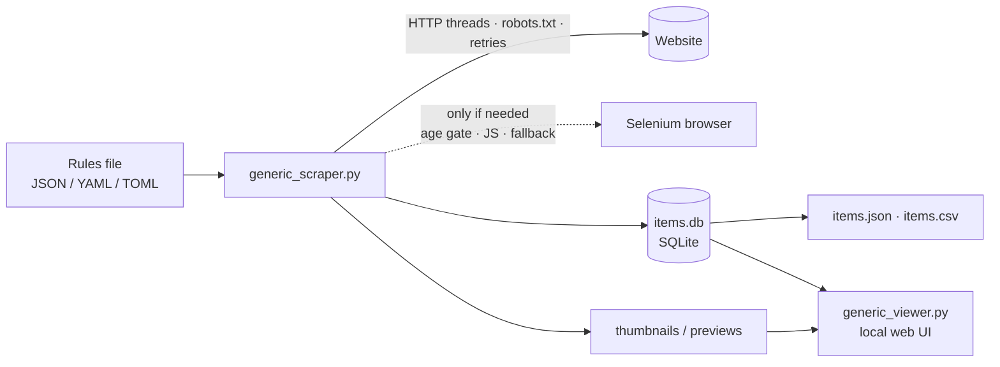

# Media Catalogue Viewer

A site-agnostic web scraper that is driven by a small **rules file**, plus a local web **viewer** for searching and exploring what it collected.

It targets the common *listing → detail* pattern (product catalogues, article lists, video libraries, directories…). Nothing about a particular website lives in the code: URL patterns, pagination, CSS selectors, ignore rules and downloads are all described in a JSON / YAML / TOML file, so supporting a new site means writing a new rules file, not new Python.

- **`generic_scraper.py`** – reads a rules file, walks the listing pages, fetches every detail page and stores everything in SQLite (plus JSON/CSV exports).
- **`generic_viewer.py`** – opens that database in your browser with full-text search, type-aware filters, sorting, grouping, "browse all values" lists and saved views. It works out each field's type on its own, so it needs no per-site setup either.

## Features

**Scraper**

- Everything site-specific lives in one rules file, **validated at startup** (bad CSS selectors or regexes are reported by name, before any request is made).
- Two pagination modes: a **URL pattern** (page count from a number, from text on the page such as "Page 1 of 50", from a total-items count, or "until a page is empty") and **next-link** following.
- **Parallel HTTP fetching** with a thread pool, gzip, retry with back-off on `429`/`5xx` (honours `Retry-After`, slows all workers down together).
- **Polite by default:** respects `robots.txt` (including `Crawl-delay`), identifies itself with a configurable User-Agent, conservative worker/delay defaults.
- **Optional real browser (Selenium)** only when a site needs it: an age-gate button, JavaScript-rendered pages, or as a fallback for pages that failed over plain HTTP.
- **Resumable:** progress is stored in SQLite; re-running skips finished items. `--start-page`, `--max-pages`, `--limit` for partial runs.
- **`--test` dry run:** fetches the first listing page and first detail page and prints what each rule extracted – the quickest way to build a rules file.
- Ad / junk-card filtering (`equals`, `contains`, "links to another website").
- Optional download of thumbnails, previews or any other file URL found in the listing.
- Exports `items.json` and `items.csv`.

**Viewer**

- Detects field types from the data: text, category, list, number (prices, "6.4K", "84%"), duration, date, image, video, URL.
- Search box with `"phrases"` and `-exclude`, plus any number of filters (text / number / date aware), sorting by any field and grouping.
- **Browse data:** every value in the database with counts (scraping dates, categories, tags…), click to filter, download as CSV.
- **Saved views** (stored in `views.json`), hover previews, local images/previews matched automatically.
- Optional password and LAN sharing.
- Python standard library only.

## How it works



## Quick start

Requires Python 3.9+.

```bash
git clone https://github.com/Saboor27/media_catalogue_viewer.git
cd config-driven-scraper

python -m venv .venv
source .venv/bin/activate            # Windows: .venv\Scripts\activate
pip install -r requirements.txt

# 1. dry run: show what the sample rules extract, write nothing
python generic_scraper.py --config sites/books_toscrape.json --test

# 2. scrape two listing pages and download the thumbnails
python generic_scraper.py --config sites/books_toscrape.json --max-pages 2 --download thumbnails

# 3. explore the result in your browser
python generic_viewer.py --config sites/books_toscrape.json
```

The sample rules target **[books.toscrape.com](https://books.toscrape.com)**, a public sandbox built for scraping practice (1,000 books, 50 pages). The automated tests run fully offline against a local mock that mirrors that site's structure; if the live site's markup differs from what the sample config expects, `--test` will show you immediately.

Optional extras: `pip install -r requirements-optional.txt` adds Selenium (age gates / JavaScript pages) and PyYAML (YAML configs).

## Scraping your own site

1. Copy `sites/template.json` to a new file. Keep rules for private sites in `sites/private/` (git-ignored).
2. Set `base_url` and the pagination rules (how do page 2, 3… differ from page 1?).
3. In your browser's developer tools, find a selector for one listing card, the link inside it, and the fields you want. Put them under `listing`.
4. Do the same for a detail page under `detail` (single `fields`, and label/value rows as `pairs`).
5. Run `python generic_scraper.py --config sites/yours.json --test` and adjust until the output looks right, then run it for real.

Every rule is explained in [docs/CONFIGURATION.md](docs/CONFIGURATION.md).

### A rules file at a glance

```json
{
  "name": "books_toscrape",
  "base_url": "https://books.toscrape.com",
  "pagination": {
    "mode": "pattern",
    "first_url": "{base}/catalogue/page-1.html",
    "url_pattern": "{base}/catalogue/page-{page}.html",
    "total_pages_from": { "selector": "li.current", "regex": "of\\s+(\\d+)" }
  },
  "listing": {
    "item_selector": "article.product_pod",
    "link": { "selector": "h3 a", "attr": "href", "absolute": true },
    "fields": {
      "title": { "selector": "h3 a", "attr": "title" },
      "price": { "selector": "p.price_color" },
      "thumbnail": { "selector": "div.image_container img", "attr": "src", "absolute": true }
    }
  },
  "detail": {
    "root_selector": "article.product_page",
    "fields": { "description": { "selector": "#product_description + p" } },
    "pairs": { "product_information": { "row_selector": "table.table-striped tr",
                                         "key_selector": "th", "value_selector": "td" } }
  }
}
```

## The viewer

```bash
python generic_viewer.py --dir output/books_toscrape                  # open a scraped folder
python generic_viewer.py --config sites/books_toscrape.json           # find the folder from the rules file
python generic_viewer.py --dir output/mysite --host 0.0.0.0 --password secret   # share on your network
```

Detection is automatic; optionally add a `viewer` section to the rules file to choose the title/image fields, card lines, labels, hidden fields or a default sort (see the configuration reference).

## Output

```
output/<name>/
├── items.db          SQLite (table `items`: url, listing JSON, detail JSON, detail_done, scraped_at)
├── items.json        everything, as JSON
├── items.csv         flattened: listing fields, detail.<field>, detail.<pair>.<key>
├── thumbnails/ ...   downloads enabled with --download
└── views.json        saved views from the viewer
```

## Command-line reference

`generic_scraper.py`

| Option | Meaning |
|---|---|
| `--config FILE` | Rules file (required) |
| `--out DIR` | Output root (default `output`) |
| `--test` | Dry run: print what is extracted, write nothing |
| `--workers N`, `--delay S` | Parallel connections / pause per request (override the rules file) |
| `--start-page N`, `--max-pages N`, `--limit N` | Partial runs |
| `--no-detail` | Listing data only |
| `--download NAME` | Enable a `downloads` entry from the rules file (repeatable, or `all`) |
| `--use-browser`, `--browser chrome\|edge\|firefox`, `--headed` | Browser options (need Selenium) |

`generic_viewer.py`: `--dir`, `--config`, `--out`, `--port` (8765), `--host`, `--password`, `--no-browser`.

## Project structure

```
generic_scraper.py        the scraper
generic_viewer.py         the viewer (server + single-page UI in one file)
sites/                    rules files: books_toscrape.json (sample), template.json
docs/CONFIGURATION.md     full rules-file reference
tests/                    offline test-suite (pytest) with a local mock shop
```

## Testing

```bash
pip install -r requirements-dev.txt
pytest
```

The suite runs offline against a local mock shop and covers the extraction rules, config validation, pagination modes, resuming, `robots.txt`, downloads, exports, the viewer's type detection / filters / sorting / grouping, its HTTP API (file-access restrictions, password, saved views) and the scraper → viewer hand-off. The included GitHub Actions workflow runs it on Python 3.9–3.12.

## Limitations

- Pages are fetched as static HTML first. JavaScript-rendered sites need the optional browser mode; sites that load data through a separate JSON API, require a login, show captchas or use infinite scroll are not supported.
- The Selenium paths (age gate, browser fallback) and YAML/TOML rules files are not covered by the automated tests; the tests exercise JSON rules files over plain HTTP.
- The sample rules were written for books.toscrape.com but are not verified against the live site in CI.
- The viewer loads the whole database into memory (it has only been tried on small datasets and is not meant for millions of items) and guesses field types heuristically; use the `viewer.types` hint to override a wrong guess. Its built-in server uses HTTP Basic authentication over plain HTTP, so use it on your own machine or a trusted network.
- A page disallowed by `robots.txt` is skipped and logged on every run.
- Developed and tested on Python 3.12. The code is written for 3.9+ (checked against the 3.9 grammar), and the CI workflow covers 3.9–3.12 once it runs on your repository.

## Responsible use

Check a website's terms of service and `robots.txt` before scraping it, keep the default request rate low, and don't collect personal data you have no right to process. `robots.txt` is respected by default; the `respect_robots` setting exists for sites you own or are explicitly authorised to crawl. Downloaded images and videos are usually copyrighted – keep them for personal analysis and do not republish them.

## Roadmap (ideas – not implemented)

- Re-check and update items whose pages changed.
- Packaging as an installable `pip` package with console commands.
- Screenshots / a short demo GIF in this README.

## Development note

Developed with AI assistance (Claude, by Anthropic) under the author's direction. The project grew out of a site-specific scraper whose requirements and real-world runs came from the author; this generic version was designed, written and tested with AI assistance.

## License

[MIT](LICENSE)
